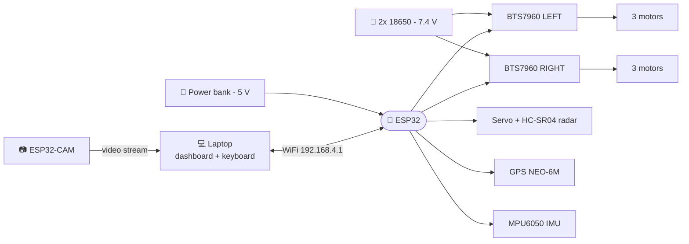
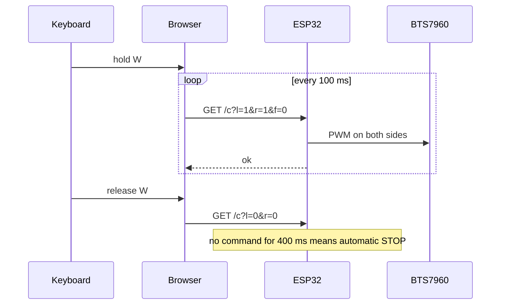

<div align="center">



<br/>

[](https://SA6196.github.io/Rover_Embedded_System/)


### A 6-wheel, WiFi-controlled ground rover with ultrasonic radar, GPS, IMU and live video, built from about ₹4,000 of hobby parts.

[Overview](#-overview) · [Status](#-project-status) · [Architecture](#-architecture) · [Hardware](#-hardware) · [Wiring](#-wiring) · [Quick start](#-quick-start) · [Controls](#-controls) · [Roadmap](#-roadmap) · [Team](#-team)

</div>

---

## 🎯 Overview

Borders and perimeters are long, remote and hard to watch around the clock. People get tired, fixed cameras have blind spots, and sending someone into every dark corner is slow and risky.

This project is an **embedded-systems prototype** that explores a different approach: a small rover that one operator can drive from a laptop, with no router and no internet. The ESP32 creates its own WiFi network, serves a live dashboard, and streams what its sensors see.

> 🎮 **Try it now:** open the [live demo](https://SA6196.github.io/Rover_Embedded_System/) and drive a simulated rover with <kbd>W</kbd> <kbd>A</kbd> <kbd>S</kbd> <kbd>D</kbd>. It behaves like the real firmware, including the radar and the double-tap speed boost.

### ✨ Highlights

| | |
|---|---|
| 🛞 **6WD skid-steer** | Two BTS7960 drivers, three motors per side, tank-style turns and a spin move |
| 📡 **Own WiFi hotspot** | Connect to `Rover`, open `192.168.4.1`. No router needed |
| ⌨️ **Keyboard driving** | <kbd>W</kbd><kbd>A</kbd><kbd>S</kbd><kbd>D</kbd> with **double-tap for turbo** |
| 🔭 **Ultrasonic radar** | Servo-mounted HC-SR04 sweeps 20°-160° and draws a live radar on the dashboard |
| 🧭 **IMU** | MPU6050 gives tilt, roll and turn angle, and warns if the rover flips |
| 🛰️ **GPS** | NEO-6M position, speed and satellites, parsed on the ESP32 with no libraries |
| 🛟 **Failsafes** | Stops if WiFi drops for 0.4 s, and blocks forward motion under 20 cm |
| 📷 **Live video** | ESP32-CAM on its own power rail (in progress) |

---

## 📊 Project status

Honest, up-to-date status of every subsystem:

| Subsystem | Status | Notes |
|---|:---:|---|
| 6WD drive with BTS7960 drivers | ✅ Working | Tested with the rover lifted, then on the floor |
| WiFi dashboard and keyboard control | ✅ Working | W/A/S/D, spin, double-tap boost, 400 ms failsafe |
| MPU6050 tilt and heading | ✅ Working | Pitch, roll, relative turn angle |
| Servo and ultrasonic radar | 🔧 Debugging | Sweep is being slowed down. Echo path under test |
| GPS (NEO-6M) | 🔧 Debugging | Needs open sky. Checking wiring and first fix |
| ESP32-CAM live video | ✅ Working | Separate 5V rail, streams over WiFi |
| Human detection (YOLO on laptop) | 🗓️ Planned | Reads the camera stream on the base station |

<sub>✅ working · 🔧 being fixed · 🚧 being built · 🗓️ planned</sub>

---

## 🧠 Architecture



**Two power rails, on purpose.** The battery runs only the motors. The ESP32 runs from a power bank, and the camera has its own 5 V supply. Motors cause voltage dips, and keeping them off the logic rail stops random resets.

<details>
<summary><b>🔍 Click to see how one key press becomes motion</b></summary>



The page reads which keys are down and mixes them into a left and a right motor value, so <kbd>W</kbd>+<kbd>D</kbd> drives in a smooth arc. A double-tap sets `f=1`, which switches the ESP32 from normal to fast PWM.

</details>

---

## 🛒 Hardware

<details open>
<summary><b>Bill of materials (click to collapse)</b></summary>

| # | Part | Qty | Price (₹) |
|---|---|:---:|---:|
| 1 | 6WD chassis with motors and wheels | 1 | 1400 |
| 2 | ESP32 dev kit | 1 | 400 |
| 3 | BTS7960 43A motor driver | 2 | 550 |
| 4 | 18650 Li-ion cell | 2 | 130 |
| 5 | Battery holder (double) | 1 | 55 |
| 6 | Battery holder (single) | 1 | 25 |
| 7 | TP4056 charger module | 1 | 24 |
| 8 | Rocker switch | 1 | 7 |
| 9 | NEO-6M GPS module | 1 | 310 |
| 10 | Wires | - | 130 |
| 11 | ESP32-CAM (OV2640) | 1 | 670 |
| 12 | SG90 micro servo | 1 | 110 |
| 13 | MT3608 boost converter | 1 | 85 |
| 14 | Capacitor | 1 | 10 |
| 15 | Solder | 1 | 20 |
| 16 | BMS | 1 | 79 |
| | **Total of the listed parts** | | **≈ ₹4,005** |

Also used, not in the original list: HC-SR04 ultrasonic sensor, MPU6050 (GY-521), resistors for the echo divider.

</details>

---

## 🔌 Wiring

> ⚠️ **Common ground:** every GND (ESP32, both drivers, servo, sensors, GPS, IMU) must be joined together.

<details>
<summary><b>⚡ Power</b></summary>

| From | To |
|---|---|
| 2× 18650 in series (7.4-8.4 V), red | Switch, then **B+** on both BTS7960 boards |
| Battery black | **B-** on both BTS7960 boards |
| Power bank (USB) | ESP32 USB port (gives 5 V on `VIN`) |
| Separate 5 V supply | ESP32-CAM 5V and GND |

Never connect the battery pack to the ESP32 pins.

</details>

<details>
<summary><b>🛞 Motors and drivers</b></summary>

| From | To |
|---|---|
| 3 left motors | LEFT board **M+ / M-** |
| 3 right motors | RIGHT board **M+ / M-** |
| LEFT **RPWM / LPWM** | ESP32 **GPIO 25 / 26** |
| RIGHT **RPWM / LPWM** | ESP32 **GPIO 27 / 14** |
| **R_EN, L_EN, VCC** (both boards) | ESP32 **3V3** |
| **GND** (both boards) | ESP32 **GND** |

</details>

<details>
<summary><b>📡 Sensors</b></summary>

| Part | Pin | ESP32 |
|---|---|---|
| SG90 servo | signal / red / brown | GPIO 13 / VIN (5 V) / GND |
| HC-SR04 | TRIG | GPIO 18 |
| HC-SR04 | ECHO | **resistor divider**, then GPIO 19 |
| HC-SR04 | VCC / GND | VIN (5 V) / GND |
| NEO-6M GPS | TX → RX2 | GPIO 16 |
| NEO-6M GPS | RX ← TX2 | GPIO 17 |
| NEO-6M GPS | VCC / GND | 3V3 / GND |
| MPU6050 | SDA / SCL | GPIO 21 / 22 |
| MPU6050 | VCC / GND | 3V3 / GND |

**Echo divider:** ECHO outputs 5 V but the ESP32 tolerates 3.3 V. Put ECHO → resistor → (junction to GPIO 19) → resistor to GND, with the bottom resistance about double the top one (1 kΩ over 2 kΩ is ideal).

</details>

<details>
<summary><b>📷 ESP32-CAM</b></summary>

Normal use needs only **5 V and GND**. It streams over WiFi, with no data wires to the main ESP32. For the one-time upload, use the USB base board or an FTDI adapter, and tie `IO0` to `GND` while flashing.

</details>

<details>
<summary><b>📍 Full pin map</b></summary>

| GPIO | Used for |
|:---:|---|
| 25, 26, 27, 14 | Motor drivers |
| 13 | Servo |
| 18, 19 | Ultrasonic TRIG, ECHO |
| 16, 17 | GPS (UART2) |
| 21, 22 | MPU6050 (I²C) |
| 2 | Onboard status LED |

</details>

---

## 🚀 Quick start

```text
Rover_Embedded_System/
├─ README.md
├─ assets/banner.svg
├─ docs/index.html            ← GitHub Pages live demo
├─ rover_sensors.ino          ← main firmware: WiFi control, radar, GPS, IMU
└─ rover_cam_final.ino        ← ESP32-CAM firmware
```

1. **Install** [Arduino IDE](https://www.arduino.cc/en/software) and add the **esp32 by Espressif Systems** board package.
2. **Open** `rover_sensors.ino` (Arduino IDE will offer to put it in its own folder, click OK). No extra libraries are needed.
3. **Select** the board `ESP32 Dev Module` and its COM port, then **Upload**.
4. **Power up:** plug the ESP32 into a power bank, then switch the motor battery on. Keep the rover still for one second so the IMU can calibrate.
5. **Connect** your laptop to WiFi `Rover` (password `rover1234`, change it in the code).
6. **Open** <http://192.168.4.1>, click the page once, and drive.

> 🧪 **First run:** lift the rover so the wheels hang in the air and test each direction before putting it on the ground.

---

## 🎮 Controls

| Key | Action |
|:---:|---|
| <kbd>W</kbd> / <kbd>S</kbd> | Forward / backward |
| <kbd>A</kbd> / <kbd>D</kbd> | Turn left / right (combine with <kbd>W</kbd> for arcs) |
| <kbd>R</kbd> | Spin |
| <kbd>Space</kbd> | Emergency stop |
| **Double-tap + hold** any drive key | 🚀 Fast mode |
| <kbd>Q</kbd> / <kbd>E</kbd> | Pan the ultrasonic left / right |
| <kbd>C</kbd> | Center the ultrasonic |
| <kbd>T</kbd> | Radar sweep on / off |
| <kbd>X</kbd> | Zero the heading |

The dashboard shows a live **radar view**, **distance**, **pitch / roll / heading**, and **GPS** (fix, satellites, latitude, longitude, speed).

---

## 🛡️ Safety and failsafes

- **Dead-man timer:** no command for 0.4 s and the motors stop.
- **Obstacle stop:** forward motion is blocked below 20 cm. Reversing and turning still work.
- **Speed caps:** PWM is limited so the 3-6 V gear motors are not over-driven by the 7.4 V pack.
- **Tilt warning:** the dashboard flags the rover if it tips past 45°.

---

## 🔧 Troubleshooting

<details>
<summary><b>Click for the problems we actually hit</b></summary>

| Symptom | Fix |
|---|---|
| Arduino: `DEADLINE_EXCEEDED` while installing the ESP32 package | Add `network:` / `connection_timeout: 3600s` to `~/.arduinoIDE/arduino-cli.yaml`, or update the IDE |
| `Write timeout` or `port busy` on upload | You picked a Bluetooth COM port. Choose the one that appears only when the ESP32 is plugged in |
| No COM port appears and no sound on plugging in | The USB cable is charge-only. Use a data cable |
| Steps print on Serial but wheels do not move | Check B+/B- voltage (7-8 V), R_EN / L_EN / VCC on 3V3, and common GND |
| Ultrasonic shows "no echo" | Check TRIG / ECHO are not swapped and rebuild the echo divider with short legs |
| GPS shows "No GPS data" | Swap TX and RX. GPS TX goes to GPIO 16 |
| GPS shows "Searching" | Go outdoors or to a window. First fix can take up to 10 minutes |
| ESP32 resets when the servo moves | Power the servo from a separate 5 V source (shared GND) |

</details>

---

## 🔭 Roadmap

- [x] 6WD differential drive
- [x] WiFi dashboard with keyboard control and failsafe
- [x] MPU6050 tilt and heading
- [ ] Slower, smoother servo sweep
- [ ] Reliable ultrasonic radar and obstacle stop
- [ ] GPS fix and route logging
- [ ] ESP32-CAM live video in the dashboard
- [ ] Human detection (YOLO) on the base station
- [ ] Waypoint navigation with a compass module
- [ ] Weatherproof enclosure

---

## ⚖️ Limitations and ethics

This is a **student prototype**, not a military-grade system. WiFi range, weather resistance, battery life and terrain ability are limited. It is built for **passive observation only**, with no weapons and no automated response. A human always stays in control.

---

## 🙏 Inspiration

Real systems that shaped the idea: **Guardium** (Israel), **DAKSH** (DRDO, India), **ROBORDER** (EU), and academic UGVs such as **Rakshak**.

---

## 👥 Team

| | |
|---|---|
| **Shivansh Agarwal** | Embedded Systems project |
| **Tanmay Shukla** | Embedded Systems project |
| **Divya Sharma** | Embedded Systems project |

---

## 📄 License

MIT © 2026 Shivansh Agarwal, Tanmay Shukla, Divya Sharma

<div align="center">
<sub>Built with an ESP32, a lot of jumper wires and very little sleep.</sub>
</div>
